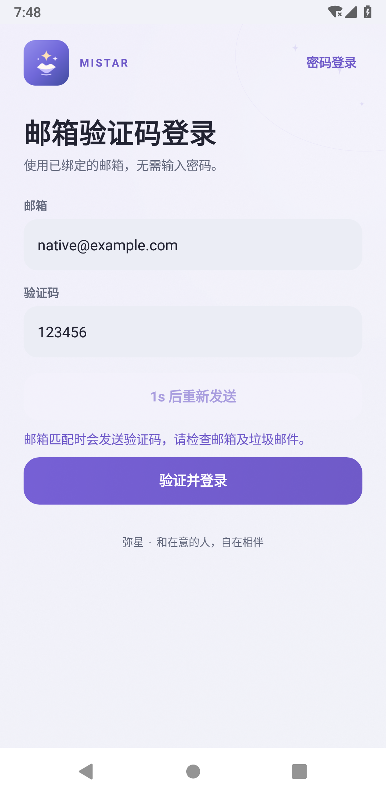

# 邮箱验证码登录 · 2.17.0

登录页顶部可切换“密码登录 / 验证码登录”，手机和手表均可使用。

1. 选择“验证码登录”，填写注册或绑定时验证过的邮箱。
2. 点击发送验证码，查看邮箱及垃圾邮件。
3. 填写6位验证码，点击“验证并登录”。无需密码或用户名。

验证码登录只用于已有账号，不会自动注册新账号，也不会重置密码。仍可切回密码登录或使用忘记密码。验证码不保存到本机偏好或页面恢复状态中；退出当前页面后，失效页面的请求结果不能触发登录。

## 服务端

需要先升级到1.22：`POST /api/auth/code` 的 `purpose=login` 申请验证码，`POST /api/login/code` 使用邮箱、`verification_id` 和验证码登录。响应会话格式、原有会话数量限制与密码登录一致。

验证码绑定唯一规范化邮箱、账号及登录用途。与注册、找回密码等用途不能混用；每次仅可使用一次，10分钟有效、最多5次错误尝试，重复发送使同用途旧码失效。保留60秒重发冷却、邮箱/来源/总体发信额度及登录尝试限制。未注册邮箱使用统一响应，不发信、不自动注册。封禁及机器人账号不能通过此入口绕过限制。

验证码消费、新会话写入及旧会话数量清理在同一数据库事务中完成，失败时回滚；并发提交同一验证码至多创建一个会话。登录不更改密码或加密聊天身份。管理员仍受既有管理操作验证规则约束。

## 验证范围

独立临时数据库与模拟SMTP检查规范化邮箱、验证码用途、错误/过期/次数上限、重发/重放、并发提交、会话事务回滚、封禁/机器人隔离、会话数量限制及原密码保持不变。原有后端各套测试继续执行。

手机与410×502、1.5倍字体手表模拟器检查顶部切换入口、输入校验、倒计时、邮箱变更、重发、失败重试、成功回调、页面重绘和失效响应。使用合成账号、拦截网络与单独测试APK，未向真实用户发送验证码，没有真机或API35运行通过的结论。
