<p align="center"></p>

# 弥星 Mistar

原生 Android 即时通讯应用：文字、图片、语音、文件、音视频通话、屏幕共享与好友动态。支持 Android 8.0+ 手机，以及 Android 9、410×502 等小屏手表。

[](https://github.com/usera3/mistar/actions/workflows/ci.yml)
[](LICENSE)

**[下载 Android 版](https://api.claudcode.xyz/xingyu/download/)** · [版本记录](CHANGELOG.md) · [自行部署](SELF_HOST.md) · [参与开发](CONTRIBUTING.md)

## 功能

- **聊天**：文字、HTML 排版卡片、图片、语音和最大 25 MiB 文件；左右头像、输入状态、最近在线、未读与已读。
- **好友群聊**：右上角“＋”选择好友创建2至20人加密群，支持文字、图片、语音、文件、HTML和成员管理；新成员无此前消息/文件权限，详见 [群聊说明](GROUPS.md)。
- **位置分享**：聊天“＋”预览地图后发送位置，或向普通好友/好友群开启实时共享；卡片含地图缩略图，详情可拖动/缩放，实时位置标记在App内更新。位置加密、时间/精度可见、通知栏可停止，详见 [位置分享](LOCATION_SHARING.md)。
- **会话与草稿**：本机加密草稿（文字、引用、光标）、置顶、消息免打扰与连续消息列表；仅搜索本机保存的联系人、文字和文件名，支持定位上下文。
- **消息操作**：深灰双排长按浮层、原生文字选区及部分复制、引用、删除/撤回、多选、批量删除和逐条转发；转发附件重新加密。
- **输入与语音**：功能/表情抽屉、向右滑动引用；语音暂停续播、拖动与1/1.5/2倍速；录音试听、手动发送及当前页面失败重试，60秒上限不会自动发送。
- **音视频**：视频铺满窗口、点击隐藏操作栏、小窗交换双方画面、完整/铺满切换；屏幕共享、桌面系统画中画、断线与忙线反馈。
- **远程协助**：普通联系人共享整屏后逐次授权，本次共享内不限时；对方可点按、长按、滑动和返回/桌面。保留本机操作、持续停止浮条，挂断或停止共享撤销。双方需2.15.1，首次需机主开启系统无障碍，服务不检索页面文字，详见 [使用与边界](REMOTE_ASSISTANCE.md)。
- **语音转文字**：长按语音选择“转文字”即开始，原消息下展示进度与文字；另有麦克风听写、预览和手动发送。
- **好友动态**：文字、图片、视频、语音、视频静态封面、点赞、评论及草稿。公共广场默认关闭。
- **个人与主题**：头像裁剪、昵称、自选主题颜色；默认紫色星光与岛屿风格。
- **界面**：头像与昵称顶部、轻量搜索、平铺会话和贴底导航，按用户提供的QQ参考对齐布局；统一输入、气泡和表单样式，兼顾自选颜色与手表大字体。
- **账号与管理**：密码/邮箱验证码登录切换、验证码倒计时、分步注册；找回密码只需绑定邮箱与验证码，无需用户名，重置后可直接用邮箱登录。支持密码修改、管理员动态审核、限发、封禁与强制下线。详见 [验证码登录](CODE_LOGIN.md)。
- **开发者机器人**：接入进度引导、投递状态、离线文档及可复制示例；直接发送 API + 签名 Webhook，无事件轮询；支持文字、HTML、图片、语音、文件及机器人音视频通话。
- **更新**：固定 HTTPS 下载、实时更新提示、大小/SHA-256/原签名检查，由用户交系统安装器确认。
- **会员与支付**：月卡/季卡/年卡，支付宝付款、本人订单、到账后开通与续费；500MiB存储、每日256MiB上传及会员头像框。非自动续费，详见 [MEMBERSHIP.md](MEMBERSHIP.md)。

<p>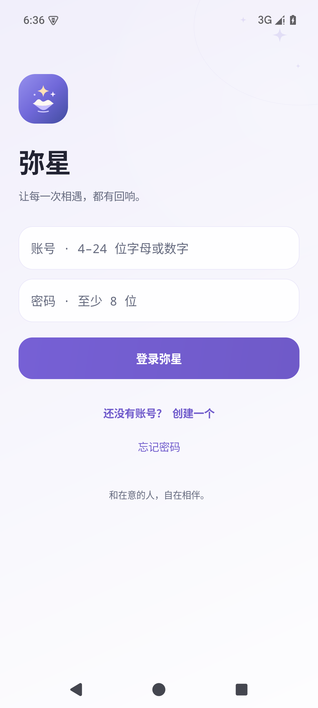 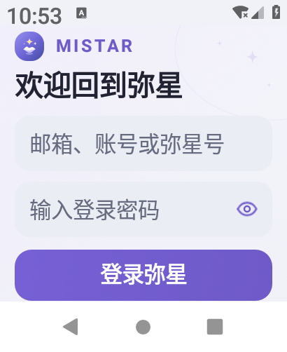</p>

<p>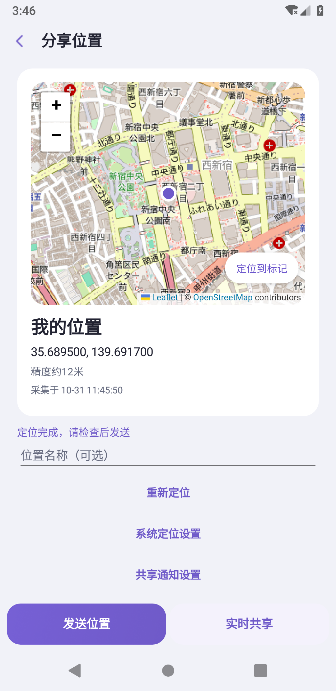 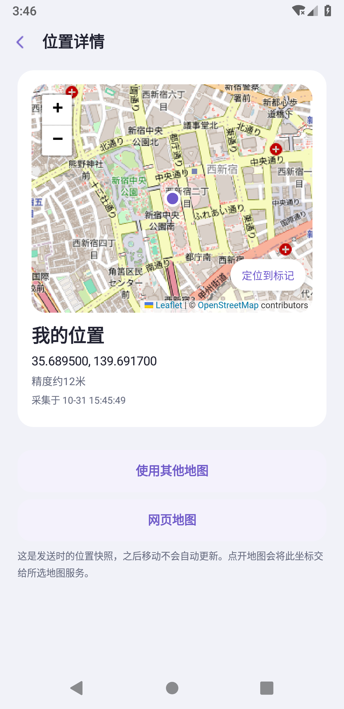 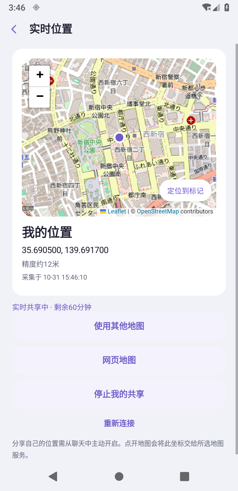</p>

<p>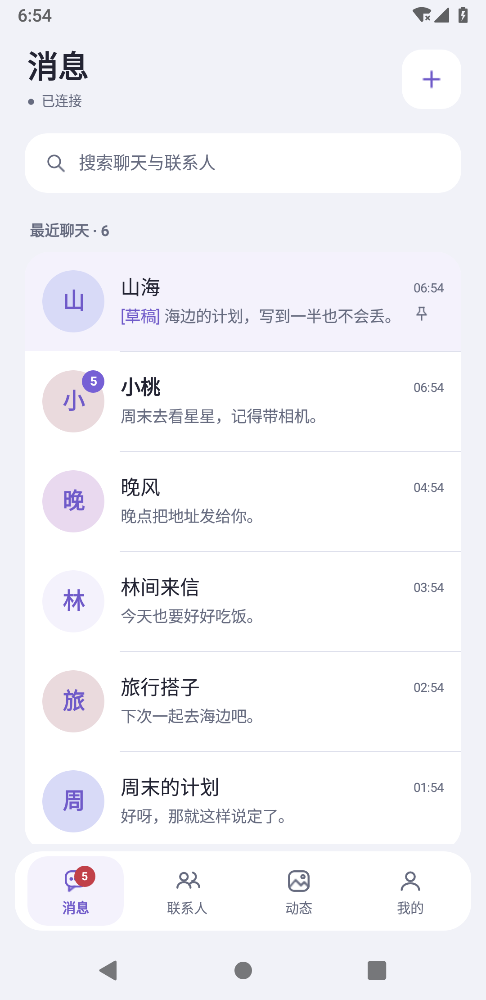 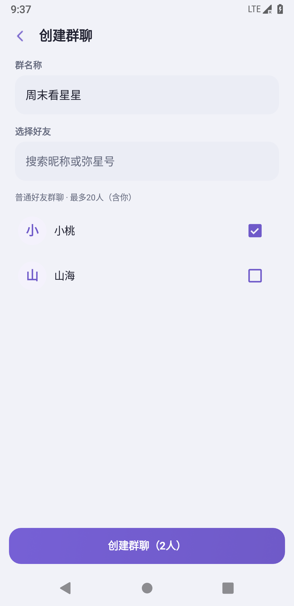 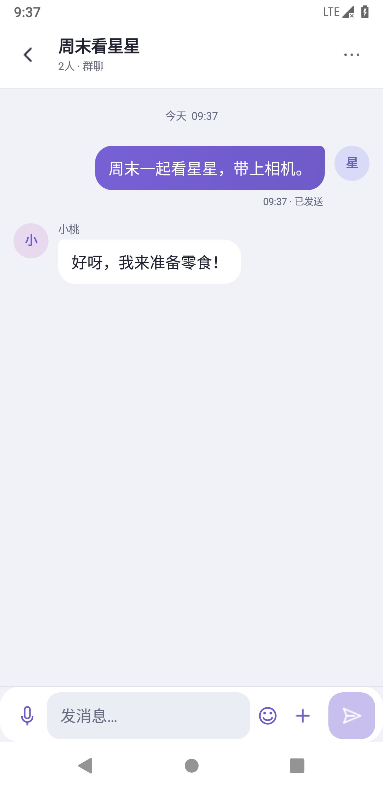</p>

<p>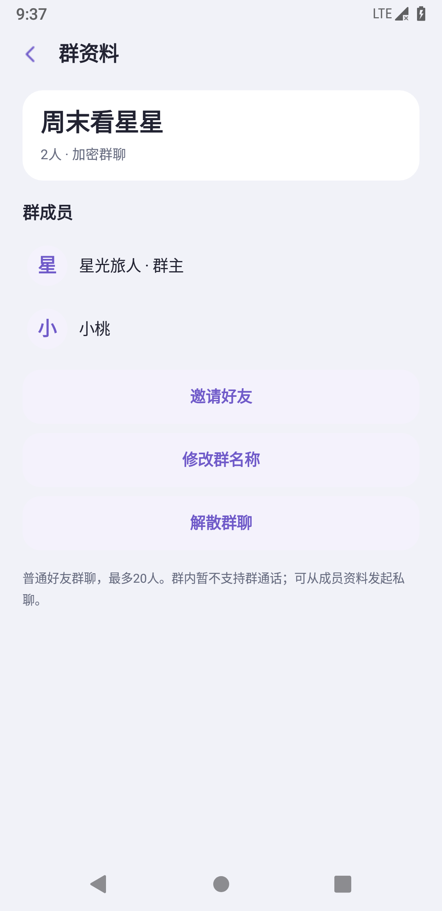 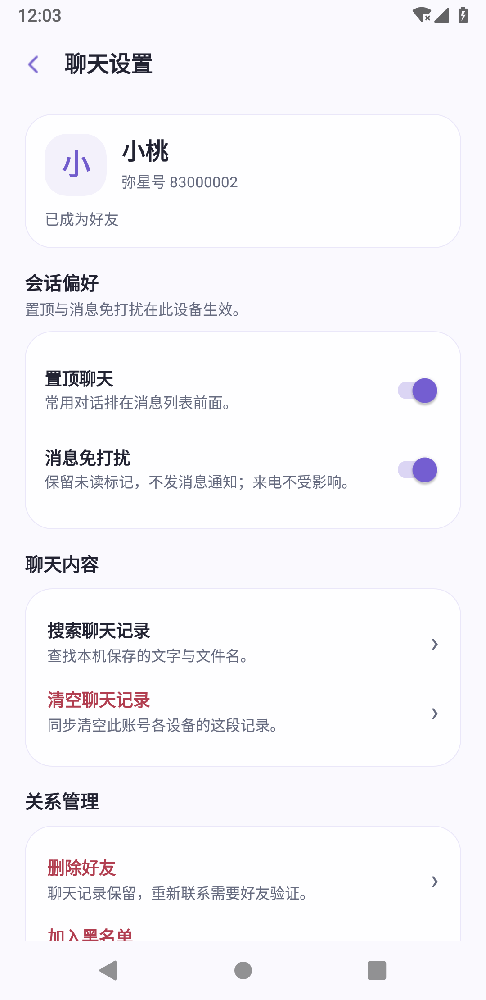 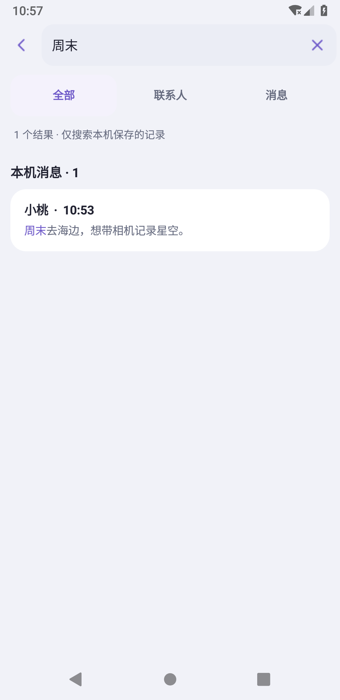</p>

<p>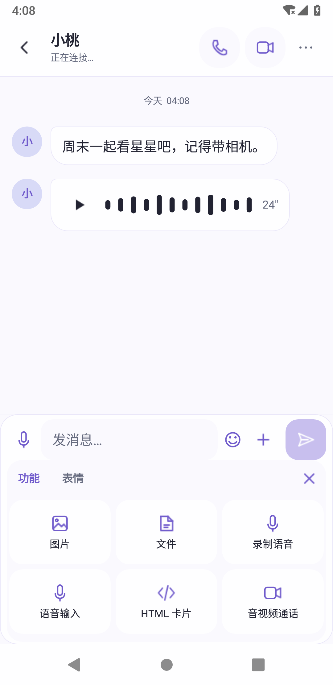 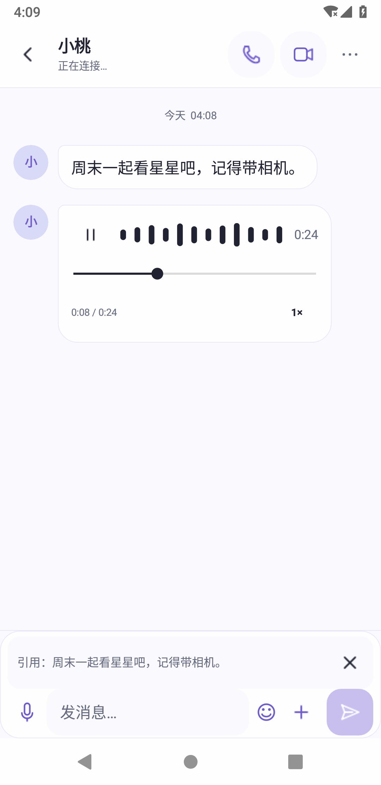 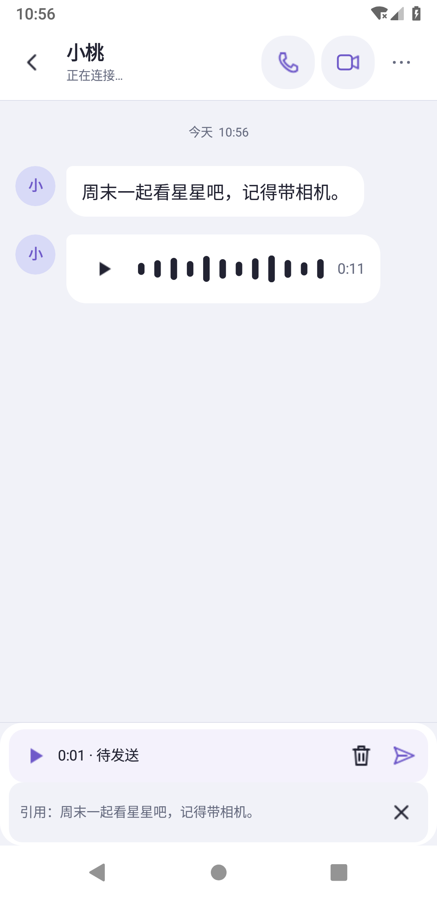</p>

[会话体验对照、实现与验证范围](CHAT_EXPERIENCE.md)

<p>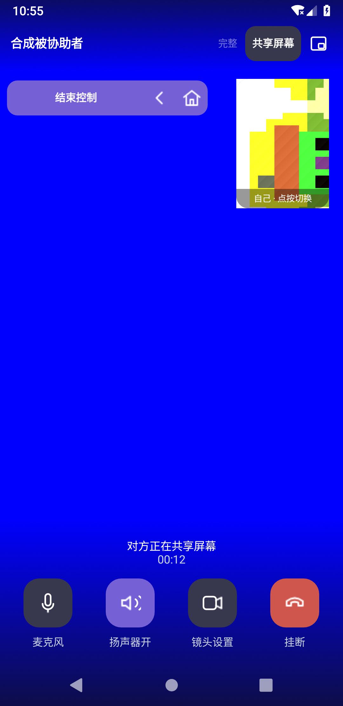 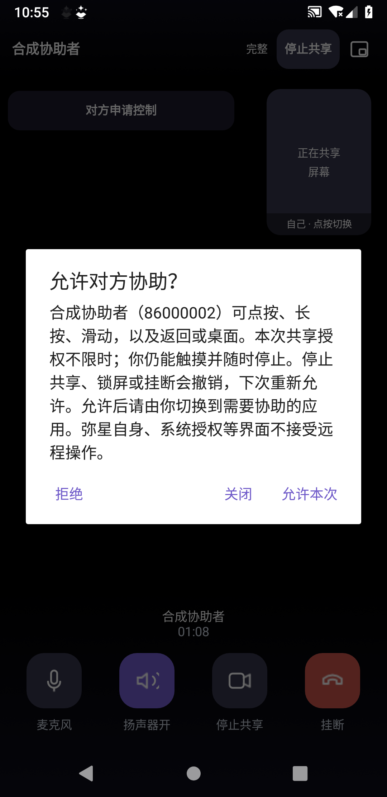</p>

<p>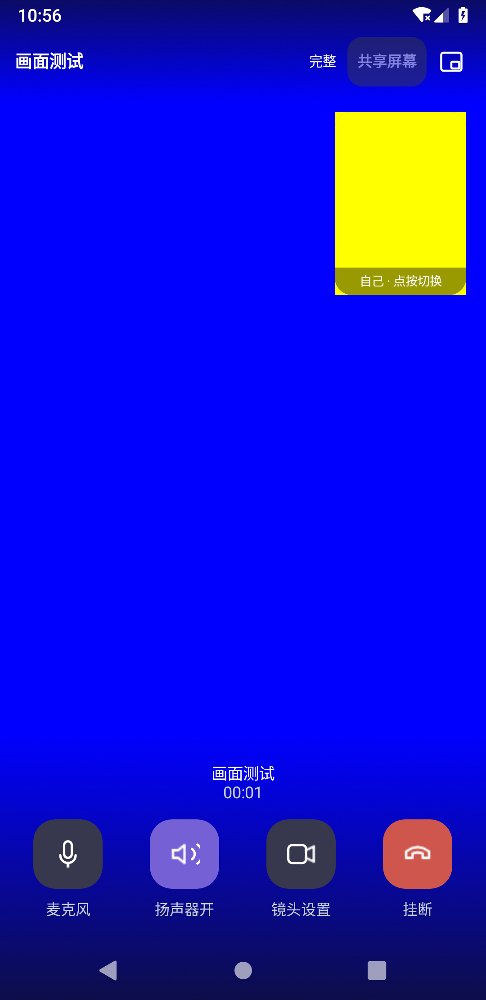 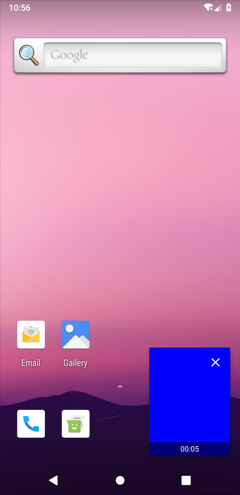</p>

## 源码结构

| 目录 | 内容 |
| --- | --- |
| `android/` | Kotlin 原生客户端、Gradle Wrapper、独立原生测试 APK |
| `backend/` | aiohttp + SQLite 后端、隔离测试及 systemd/nginx/TURN 模板 |
| `bot-examples/` | Python REST/Webhook 消息示例及可选 aiortc 通话示例 |
| `distribution/` | 静态下载页面与图标 |
| `tools/` | 隔离后端测试和公开源码检查 |

## 构建 Android

需要 JDK 21、Android SDK Platform 36 / Build Tools 35.0.0。AGP 8.11.1、Kotlin 2.1.20、Gradle 8.13 已在项目中固定。

```sh
cd android
./gradlew :app:assembleDebug
# Windows: gradlew.bat :app:assembleDebug
```

输出为 `android/app/build/outputs/apk/debug/app-debug.apk`。通过 `ANDROID_HOME` 或本机 `android/local.properties` 配置 SDK；不要提交本机路径。正式构建使用自己的签名密钥，通过 `QINGLIAO_KEYSTORE` 和 `QINGLIAO_SIGN_PASSWORD` 提供，仓库不含官方签名材料。独立原生测试的 `testBuildType` 为 `release`，需要为主/测试包提供同一测试签名。

默认客户端连接现有公开服务；自行部署时请按 [SELF_HOST.md](SELF_HOST.md) 配置服务地址、信任证书、TURN 和独立的更新签名。自行签名的 APK 不能覆盖官方签名的安装包；不要为了安装开发版卸载存有聊天身份的官方客户端。

## 运行后端与测试

```sh
python3 -m venv .venv
. .venv/bin/activate
python -m pip install -r backend/requirements.txt
python tools/run_backend_tests.py
```

测试在独立进程和临时数据库中运行，验证码在内存捕获，不连接真实邮箱、不联系真实用户。服务端环境变量见 `backend/.env.example`；程序直接读取进程环境，部署配置方法见 [SELF_HOST.md](SELF_HOST.md)。

## 协议与使用说明

[消息操作](MESSAGE_ACTIONS.md) · [通话界面与小窗](CALL_UI.md) · [会员与支付](MEMBERSHIP.md) · [机器人 API](BOT_API.md) · [机器人通话](BOT_CALLS.md) · [语音输入](DICTATION.md) · [屏幕共享](SCREENSHARE.md) · [管理员](ADMIN.md) · [更新发布](UPDATES.md) · [资源与滥用限制](DEFENSE.md)

## 加密与边界

普通用户之间的新私聊正文、附件和通话信令采用 Tink HPKE/签名及分段附件认证；本机聊天身份、会话和缓存使用 Android Keystore/AES-GCM。没有实现 Signal Double Ratchet，也未经过独立安全审计。机器人内容由后端和开发者处理；头像、好友动态及其媒体不属于私聊端到端加密范围。语音识别由第三方在线服务处理用户主动选择的声音。完整说明见 [SECURITY.md](SECURITY.md)。

后台消息依赖连接常驻服务；应用被系统强行停止后需重新打开。尚无群聊、跨设备接管通话或 iOS 客户端。测试覆盖自有手机/手表模拟器与合成媒体，没有真机适配承诺。

仓库包含客户端、后端与通用机器人示例，不包含线上数据库、用户内容、签名密钥、SMTP/机器人/模型凭据，也不包含 Miko 的个人知识图谱、图片库或语音模型。

## 许可

项目原创代码以 [MIT](LICENSE) 开源；Concentus、Gradle Wrapper 及其他第三方组件保留原许可，见 [THIRD_PARTY_NOTICES.md](THIRD_PARTY_NOTICES.md)。
