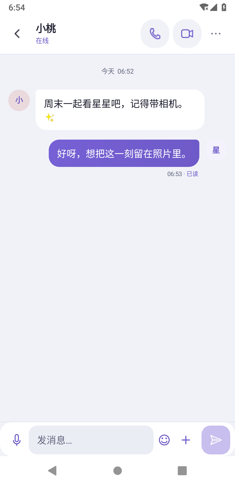
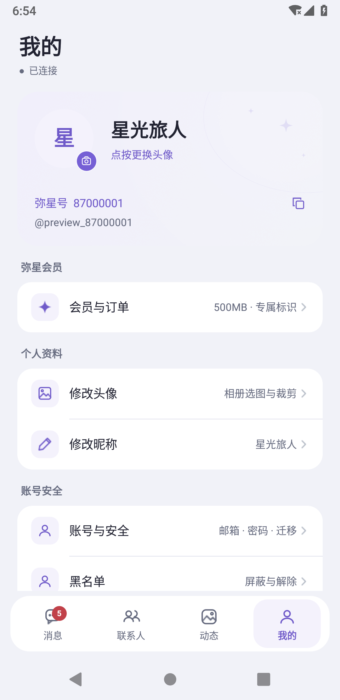
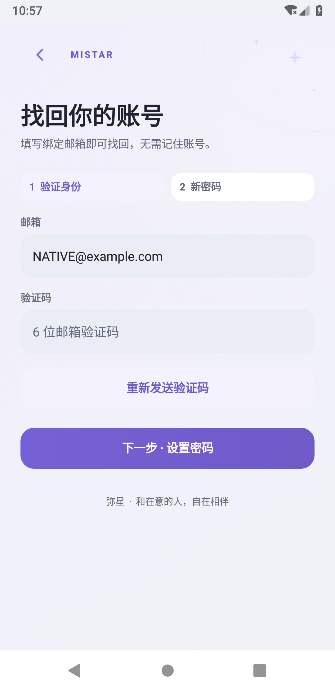

# 弥星 2.16.0 视觉优化

此次直接调整原生Android界面，不使用网页替代聊天或通话页面。

  

## 视觉层次

- 以浅灰画布和白色内容面板区分页面层级，减少卡片、气泡和输入区的重复描边。
- 主题色集中在主要操作、选中导航、本人气泡、状态和图标上。默认弥星紫，仍可自由选择颜色。
- 输入框使用独立的浅色底面，获得焦点时出现清晰的主题色边框。登录、注册、找回密码及开发者表单采用同一组样式。
- 对比度依据实际配色计算；明黄、纯白等颜色会使用更深的文字或图标，不直接把浅色当正文。

## 主要页面

- 消息首页缩短重复标题区，保留连接状态、搜索、草稿、置顶和未读标记。
- 联系人改成有内部分隔线的连续列表，减少每一行的独立卡片与空隙。
- 底部四个入口保留固定文字和触摸位置，选中底色在入口之间短距离移动。快速切换时复用同一个导航控件，不堆叠旧导航。
- 聊天气泡和文件图标统一为当前主题，保留左右头像、原生文本选区、深灰双排消息操作、多选、转发和删除。
- 输入区、个人页图标和通话按钮采用一致的圆角层次。视频按钮缩小视觉占用，视频仍铺满原有窗口。
- 找回密码取消用户名输入：填写绑定邮箱与验证码后设置新密码；成功后登录页自动填入邮箱。登录提示也明确支持邮箱，减少忘记账号时的阻碍。
- 唤起通话操作栏使用短过渡；隐藏和进入画中画时立即移除操作区，避免看不见的按钮继续接收点击。

## 过渡与边界

导航只对选中底色做220毫秒的插值，不移动文字和触摸目标；中途切换从当前显示位置继续。没有持续运转的装饰动画、实时背景模糊或额外网络请求。沿用系统动画设置，系统关闭动画时直接显示最终状态。

手机和小屏使用各自的间距与字级。手表保留可滚动表单、精简标题和较短的工具面板；不强行缩放整张手机界面。

## 验证范围

自有API28手机模拟器与410×502、1.5倍字体手表模拟器覆盖主题对比度、导航选中/复用/连续切换、布局边界和左右头像，并检查原有登录/注册/开发者、会员页面、草稿/搜索、语音、消息长按、通话/画中画、屏幕共享和远程协助。使用合成账号和媒体，网络请求被测试拦截，不创建真实账号、消息或付款。

12种颜色包括10组预设以及纯白、纯黑；对比度计算不等同于完整的无障碍审计。没有真机或连续长时间性能测试，没有API35运行通过的结论；SDK36构建和实际执行的模拟器测试分别记录。远程协助仍按 [本次共享不限时](REMOTE_ASSISTANCE.md) 的规则工作。

邮箱找回需要先部署服务端1.21。邮箱已有唯一索引，不新增数据库结构或改变验证码期限；未知邮箱使用统一响应，不公开邮箱是否注册。重置时校验验证码绑定的账号、邮箱、用途与有效期，不依据客户端可选的旧用户名字段切换目标。独立的临时数据库与模拟SMTP测试覆盖邮箱大小写、错误邮箱/验证码、冷却、过期、重放、尝试上限、跨用途、账号隔离和会话撤销。
